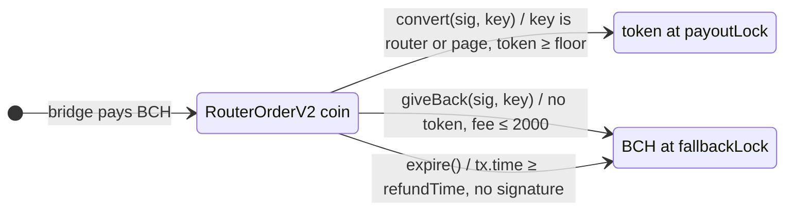
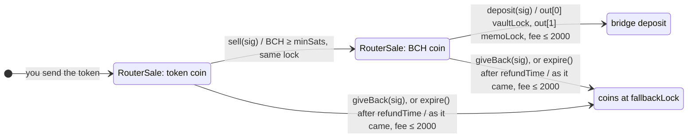
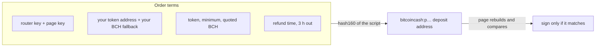
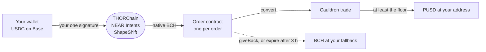
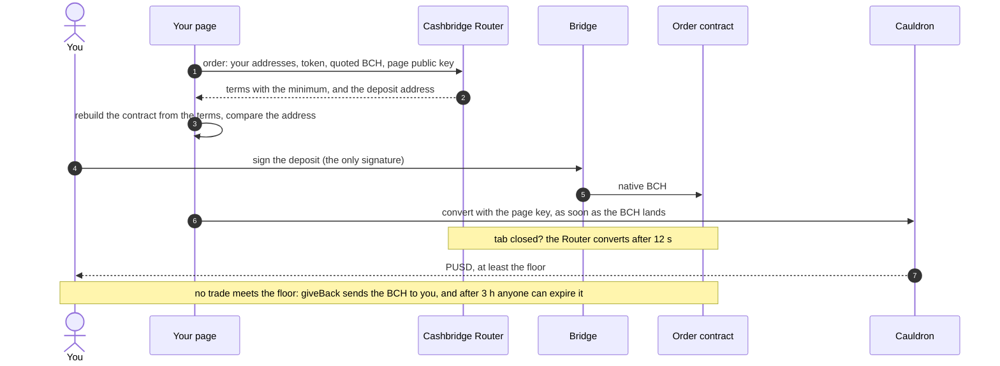
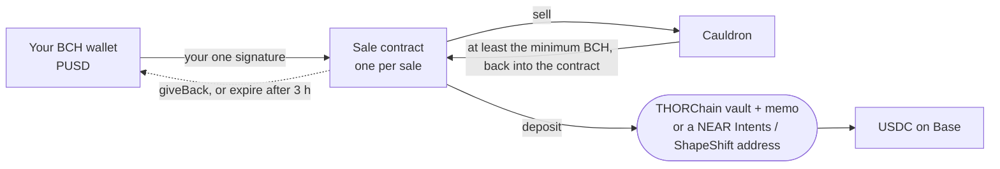

# Cash Bridge

Bridge assets to Bitcoin Cash and Cauldron CashTokens, and back. Live at https://www.cashbridge.space.

Three bridges carry the BCH path: [THORChain](https://thorchain.org), [NEAR Intents](https://docs.near-intents.org) (1Click) and [ShapeShift](https://shapeshift.com) (public swap API). Each is quoted wherever it carries the pair: plain BCH both ways, CashTokens both ways (Manual, and the Cashbridge Router when it admits the route), and **Any network** free pairs. The form shows what each would deliver after the gas its deposit costs on the source chain, and takes the best one. NEAR Intents and ShapeShift are plain transfers to a one-use deposit address, with no Cashbridge contract on that leg; their payouts are checked on the destination chain like THORChain’s. ShapeShift’s BCH quotes are NEAR Intents swaps underneath, so the page and the Router check each one against 1Click before it is used.

By default (**Manual**) the user signs every step in their own wallets. For transfers that settle a Cauldron token (and for plain BCH when you prefer), the **Cashbridge Router** lets the user sign once in the source wallet while the service finishes settlement under the order’s terms. When the service returns a contract order (`apiVersion=2`), the deposit is a per-order P2SH purchase or sale covenant: spending is limited to paying the quoted minimum (or the fixed THORChain deposit on a sale) or returning funds to the fallback; after `refundAfter` (set about three hours from order creation; Bitcoin Cash median time runs about an hour behind wall clock) anyone may return them on those terms. Legacy orders used temporary P2PKH custody; the two oldest Router rows in [Proof on mainnet](#proof-on-mainnet) are that model, and the later ones ran through the contracts. ERC-20 approval may still need a separate transaction. See the [docs](https://www.cashbridge.space/docs), [transaction flows](docs/how-it-works.md) and [security and custody](https://www.cashbridge.space/docs/security).

Promo film on the landing page: [`/landing/cashbridge-promo.mp4`](https://www.cashbridge.space/).

**[Watch the video demo on X (4:45)](https://x.com/AstralEX163/status/2124059434062426491)**

[](https://x.com/AstralEX163/status/2124059434062426491)

AI agents use the MCP server at `https://www.cashbridge.space/mcp`: list assets, quote (THORChain, NEAR Intents, ShapeShift), prepare an unsigned deposit for the user’s wallet (including Cashbridge Router purchase/sale and Any-network free pairs), report the source tx, and read status. The server holds no keys. Add it with `claude mcp add --transport http cash-bridge https://www.cashbridge.space/mcp`; see the [agent docs](https://www.cashbridge.space/docs/agents).

Forked from the [swap.thorchain.org](https://github.com/thorchain/swap.thorchain) interface.

## Strengths

- With the Cashbridge Router you sign once, in the source wallet, whichever of THORChain, NEAR Intents and ShapeShift carries the BCH. The Router buys the token on Cauldron and pays it out. An ERC-20 token sent through THORChain may need an approval first.
- Bridging back takes one signature as well: your BCH wallet sends the token to a sale contract, and the Router sells it and deposits the BCH to the bridge.
- THORChain, NEAR Intents and ShapeShift are quoted side by side, each with what it would deliver and how long it takes. The form picks the one that delivers the most, and you can pick another.
- The Router finishes the transfer after you close the tab. Until then the BCH waits in a contract made for that order, which can only pay out the token or give the BCH back.
- You can receive without connecting a wallet: paste a token-aware `bitcoincash:z…` address for PUSD, or the payout address on the other chain when you bridge back.
- PUSD, MUSD, plain BCH and any other token with a Cauldron pool.
- USDC and USDT on the EVM chains, Solana, TRON, TON, Sui and NEAR, among more than 20 source chains.
- WizardConnect and WalletConnect on Bitcoin Cash. On the other chains, WalletConnect and browser, mobile and hardware wallets, Ledger and Trezor included.
- Cash Bridge charges no fee of its own. Network, bridge and pool fees are shown before you sign.
- The scanner finds a wallet's transfers from any device and links every transaction.
- The interface comes in 24 languages, and AI agents can quote and prepare transfers over MCP.
- Real transfers on mainnet, each step linked to a public explorer. See [Proof on mainnet](#proof-on-mainnet).

## How the smart contracts work

With the Cashbridge Router your coins never sit in a wallet the service controls. Each order gets its own small [CashScript](https://cashscript.org) contract on Bitcoin Cash, and every way out of it pays you: the token you asked for, or your coins back. The full walkthrough, with animated diagrams and a floor calculator, is at [/docs/smart-contracts](https://www.cashbridge.space/docs/smart-contracts).

### At a glance, for developers

Each box is a coin locked in the contract; each arrow is one function and the checks it makes. `i` is the index of the coin being spent, and every check reads `tx.outputs[i]`.





```text
RouterOrderV2(router, page, payoutLock, fallbackLock, token, minTokens, quotedSats, refundTime)
  floor = min(in[i].value × minTokens ÷ quotedSats, minTokens)
RouterSale(router, vaultLock, memoLock, fallbackLock, minSats, refundTime)
RouterSaleExact(router, vaultLock, memoLock, fallbackLock, depositSats, minSats, refundTime)
  deposit: out[0] gets exactly depositSats, out[1] the memo, out[2] the rest at fallbackLock
```

### The terms are the address

The contract's terms are written into its script, and the deposit address is the hash of that script (P2SH20, because THORChain pays only 20-byte script hashes). Your page rebuilds the address from the order's terms, checks the addresses it gave, and refuses any other address, so a matching address is proof of the terms.



### Into Bitcoin Cash: the order contract



| Way out | Who can use it | When | What you get |
|---|---|---|---|
| `convert` | the Router's key or your page's one-use key | any time | the token at your address, at least the floor |
| `giveBack` | the same two keys | any time | the BCH at your fallback, at most 2,000 sats to the miner |
| `expire` | anyone | after the refund time | the same as `giveBack` |

The floor is `min(coin × minTokens ÷ quotedSats, minTokens)`: a bridge that pays a little less BCH than quoted still gets its token, at a proportionally lower floor. Each check reads the output with the same index as the coin being spent, so one payout can never settle two coins. Only the order's largest coin of at least half the quoted BCH settles it; dust under 1,000 sats is ignored and any other coin goes back to you.



### Back out: the sale contract



| Way out | Who can use it | What it may do |
|---|---|---|
| `sell` | the Router | a Cauldron sale that pays at least the minimum BCH, with no token, back into the same contract |
| `deposit` | the Router | the contract's BCH, alone in its transaction, to the bridge in the terms with the memo; at most 2,000 sats to the miner |
| `giveBack` | the Router | every coin back to you exactly as it came: same token, amount and commitment |
| `expire` | anyone, after the refund time | the same as `giveBack` |

ShapeShift takes an exact amount, so its sales use [`router-sale-exact.cash`](contracts/router-sale-exact.cash): the deposit pays exactly the quoted BCH and the rest comes back to you as plain BCH.

### What the script guarantees, and what you trust

| Guaranteed by the script | Trusted to Cash Bridge |
|---|---|
| Coins leave only to your addresses, or to the bridge deposit fixed in a sale's terms | The price between your minimum and the best trade |
| A token payout is at least the floor | When to act before the refund time |
| A refund leaves at most 2,000 sats per coin to the miner | The bridge paying out: THORChain, NEAR Intents or ShapeShift |
| After the refund time anyone can send the coins back | Your page's one-use key while it sits in your browser |

Sources: [`contracts/`](contracts) (CashScript 0.14; `npm run contract:compile` rebuilds them with cashc 0.14.0). The page and the Router build every address and unlocking script from the bytecode in [`src/lib/router-contract.ts`](src/lib/router-contract.ts), sign with Schnorr and `SIGHASH_ALL | SIGHASH_UTXOS`, and run each signed transaction through the Bitcoin Cash VM before it is broadcast. `npm run test:auto-bridge` runs the contracts in the VM on real Cauldron trades, including the spends that must fail: a payout to anyone else, one unit under the floor, another key, an early `expire`, a fee over the cap.

## How Cash Bridge meets the bounty

Cash Bridge is an entry for the BCH BLAZE 2026 [Stablecoin Bridge bounty](https://bchblaze.cash/bounties/stablecoin-bridge/). The same list, with links into the app, is at [/docs/bounty](https://www.cashbridge.space/docs/bounty).

| The bounty asks | Cash Bridge |
|---|---|
| "convert stablecoins on other chains to BCH stablecoins (eg USDC on ETH into PUSD on BCH)" | USDC and USDT on Ethereum, Base, Arbitrum, Optimism, Polygon, BNB Smart Chain, Avalanche, Solana, TRON and more, to PUSD, MUSD or any Cauldron token, through THORChain, NEAR Intents or ShapeShift and then Cauldron. [Try it](https://www.cashbridge.space/sell-ETH.USDC-buy-PUSD) |
| "And vice-versa, BCH stables to other-chain stables (eg PUSD on BCH into USDC on ETH)" | PUSD, MUSD or any Cauldron token back to USDC, USDT or any asset the three bridges pay out. [Try it](https://www.cashbridge.space/sell-PUSD-buy-ETH.USDC) |
| "from BCH stables to multiple/any other ecosystems would be even better" | More than 20 source chains. Stablecoins come from the EVM chains, Solana, TRON, TON, Sui and NEAR |
| "The faster, cheaper, and easier to use the bridge is - the better." | The token is bought as soon as the bridge's BCH reaches the mempool, and the Cashbridge Router finishes after the tab closes. No Cash Bridge fee: three bridges are quoted side by side and the best one is picked. One signature each way with the Router. 24 interface languages and an MCP server for agents |
| "On the BCH side, WizardConnect is highly recommended." | WizardConnect for Selene, Paytaca and any WizardConnect wallet; WalletConnect for Cashonize and Zapit. [Wallets](https://www.cashbridge.space/docs/wallets) |
| "On the other chain side, WalletConnect is probably essential" | WalletConnect, plus browser, mobile and hardware wallets |
| Stretch: more than one BCH stablecoin | PUSD and MUSD, and any token with a Cauldron pool |
| Stretch: "route through large popular and existing multicoin providers like ShapeShift, ThorChain etc." | THORChain, NEAR Intents and ShapeShift, each quoted wherever it carries the pair |
| "ParyonUSD … first priority integration & demo" | PUSD is the default destination, identified by its category id |
| Mainnet Track: a BCH mainnet transaction | Every transfer, with explorer links. See [Proof on mainnet](#proof-on-mainnet) |
| Mainnet Track: a demo from before the hackathon, for a pre-existing project | Before 14 November 2026 we had connected the THORChain API, run the first swaps by hand from a local build and bought the domain. The [pre-BLAZE demo](https://www.cashbridge.space/docs/demo) lists those mainnet transactions |

## Use Cash Bridge

1. Open the [bridge](https://www.cashbridge.space/bridge), choose the source asset and receive BCH, PUSD, MUSD or another Cauldron token.
2. Enter an amount, connect the source wallet and choose the BCH recipient. In Manual mode, connect your BCH wallet to sign the token purchase; with the Cashbridge Router, you can paste a receiving address.
3. Review the route (THORChain, NEAR Intents or ShapeShift, whichever quote), minimum, fees and fallback before signing. Follow the transfer on its progress screen, and later in the [scanner](https://www.cashbridge.space/scanner) by wallet address, with links to its transactions.

To bridge back, reverse the form. Manual mode sells the CashToken to BCH and then asks your BCH wallet to sign the bridge deposit. When available, Router sales let your wallet send the token to a sale contract; the service sells it and deposits the BCH to the chosen bridge (THORChain’s vault with the agreed memo, or a NEAR Intents or ShapeShift deposit address), or returns the funds. These are several on-chain steps, not an atomic swap. See [bridging back](https://www.cashbridge.space/docs/guides/bridge-from-bch).

The [wallet guide](https://www.cashbridge.space/docs/wallets) covers WizardConnect and WalletConnect on BCH, and browser, mobile and hardware wallets on the other chains. Availability depends on the wallet and network. Cash Bridge adds no application fee; network, bridge and Cauldron pool fees still apply, and liquidity and provider limits affect each quote. See [fees and limits](https://www.cashbridge.space/docs/fees).

The scanner finds a wallet's Router orders and THORChain swaps from any device, and this browser's own transfers on this device. The Router service continues an order after the tab closes; Manual steps still need your wallet. If a wallet answer is lost, check the transaction or use **Already paid?** before sending again. See [tracking and recovery](https://www.cashbridge.space/docs/guides/track-a-transfer).

## Proof on mainnet

Real transfers through https://www.cashbridge.space, end to end, in both directions, newest first. Every link opens the
transaction on a public explorer; a **THORChain swap** link opens the cross-chain leg on [thorchain.net](https://thorchain.net)
and a **NEAR Intents swap** link opens it on the [NEAR Intents explorer](https://explorer.near-intents.org). The same list is
in the [docs](https://www.cashbridge.space/docs/mainnet).

### Into Bitcoin Cash (10)

| Date | Route | Sent → received | Transactions |
|---|---|---|---|
| 20 Nov 2026 | TON → PUSD<br>**Cashbridge Router** · NEAR Intents · order contract | 2.68943 TON → 0.0139448 BCH → 2.61 PUSD | [TON deposit `7935dc…fdc8`](https://tonviewer.com/transaction/7935dc078f614b99f0b89bb262d97c92987bb0da3ea2bc380e5ccbb7fb7cfdc8) · [NEAR Intents swap](https://explorer.near-intents.org/transactions/UQAd3hu2yTWESAYp2ryqwhl8f8qzPeVHf9CtGahi6FDmKqJt) · [BCH to contract `f73610…7911`](https://explorer.selene.cash/tx/f73610484aba18031fa23e97f946f740f0b27286d21eb1d1d3cf1fb21a437911) · [PUSD payout `a363c0…9618`](https://explorer.selene.cash/tx/a363c0be8fe6749a4d94d3e5a1a6b4d10461cf9e98c05443e72305a8638b9618) |
| 20 Nov 2026 | USDT (BNB Smart Chain) → PUSD<br>**Cashbridge Router** · NEAR Intents · order contract | 1.97137 USDT → 0.00989847 BCH → 1.95 PUSD | [USDT deposit `0x589a…72ae`](https://bscscan.com/tx/0x589ae6780bdd454a0afa38c6e8c03b9c211e47e5dcb1c8947238eb6d268272ae) · [NEAR Intents swap](https://explorer.near-intents.org/transactions/0x65001523f7118e27D3820532357c2E4C59a862dB) · [BCH to contract `6b5ffa…e2fe`](https://explorer.selene.cash/tx/6b5ffa400171a9df42301f0f912533f054e28c994fbf4f20dcc354717b3be2fe) · [PUSD payout `a1dd10…92e0`](https://explorer.selene.cash/tx/a1dd1067dc7b9fe9cbce05a8f9c37e1c2ef75fd733ab1a815ec2969460be92e0) |
| 20 Nov 2026 | USDC (Base) → PUSD<br>**Cashbridge Router** · NEAR Intents · order contract | 99.8932 USDC → 0.49994357 BCH → 98.93 PUSD | [USDC deposit `0x8906…b3cb`](https://basescan.org/tx/0x890604ed3c895565571b122644022f7d3ec452e025ed89acd297aa011fddb3cb) · [NEAR Intents swap](https://explorer.near-intents.org/transactions/0x509c39ee45C24E0e42814a0E705F94095FA089ed) · [BCH to contract `44fcf1…3190`](https://explorer.selene.cash/tx/44fcf1b08c3c417e26ceb41ade7b9d562bfd30a34da597382b601f9525bd3190) · [PUSD payout `8a9b6c…2ab5`](https://explorer.selene.cash/tx/8a9b6c3acb9dd330ec3e54369568867232b3b53305cf8f932491f93c0a5e2ab5) |
| 20 Nov 2026 | USDC (Base) → PUSD<br>**Cashbridge Router** · NEAR Intents · order contract | 5 USDC → 0.02449021 BCH → 4.93 PUSD | [USDC deposit `0xc4f9…e35f`](https://basescan.org/tx/0xc4f9d9ef1b3e0406908eac16aee46eb418111f27a2504f197da1177c41f6e35f) · [NEAR Intents swap](https://explorer.near-intents.org/transactions/0x435c854B89BE175F79f05AE9Ffbfc367D9F2052f) · [BCH to contract `394584…22b8`](https://explorer.selene.cash/tx/394584f5437ace7fa8688838ad989302ebb72337e7d5cdcc44fc5fa5d0ed22b8) · [PUSD payout `bcb730…8cb0`](https://explorer.selene.cash/tx/bcb7309b577e4063eb7b60b9b3bf805739553edf3f942e5cf76a3b7e944f8cb0) |
| 19 Nov 2026 | ETH (Base) → PUSD<br>**Cashbridge Router** · THORChain · order contract | 0.00419841 ETH → 0.03481972 BCH → 0.03481596 BCH back, the contract gave the BCH back to the fallback address | [ETH deposit `0x2b2b…e04d`](https://basescan.org/tx/0x2b2bf1b709c126ca2ae49e7e505d961e4f306cb4199cc2bf2139cffb8f0ee04d) · [THORChain swap](https://thorchain.net/tx/2b2bf1b709c126ca2ae49e7e505d961e4f306cb4199cc2bf2139cffb8f0ee04d) · [BCH to contract `93c651…e16b`](https://explorer.selene.cash/tx/93c651c63cbbdfc636d98fbac26dd2eda740dc90335e728e71f660fa05bce16b) · [BCH refund `cbc2a2…3349`](https://explorer.selene.cash/tx/cbc2a2b00b7c758997f81dc0b2f0d7447b04a24c6584ed79679078a0d3c63349) |
| 19 Nov 2026 | USDC (Base) → PUSD<br>**Cashbridge Router** · THORChain · order contract | 3 USDC → 0.01306603 BCH → 2.71 PUSD | [USDC approval `0x8404…740b`](https://basescan.org/tx/0x840444ab096bfda4a767bfb6e0e924b65cc8cd4b421654a611fe7b1419cf740b) · [USDC deposit `0xe866…e18c`](https://basescan.org/tx/0xe8660dc09f7976a12fbcce1638973412d2dec4c1de86b067ab98b8c64525e18c) · [THORChain swap](https://thorchain.net/tx/e8660dc09f7976a12fbcce1638973412d2dec4c1de86b067ab98b8c64525e18c) · [BCH to contract `38b2f4…d6d8`](https://explorer.selene.cash/tx/38b2f49613c07e9ef918c9612d192623730cda0919770b4efed3429ee55cd6d8) · [PUSD payout `15b4f8…96f0`](https://explorer.selene.cash/tx/15b4f826e22ed0b4982862f20b4f2781fb527cd72cc611aa14a5bd45b8a496f0) |
| 18 Nov 2026 | ETH (Ethereum) → PUSD<br>**Cashbridge Router** · THORChain · legacy order address | 0.0239214 ETH → 0.20364266 BCH → 42.77 PUSD | [ETH deposit `0x8760…bd59`](https://etherscan.io/tx/0x8760d8dca4ef0469ff807c2224b103ced60d4a15a7a406f6bd73dbb12826bd59) · [THORChain swap](https://thorchain.net/tx/8760d8dca4ef0469ff807c2224b103ced60d4a15a7a406f6bd73dbb12826bd59) · [BCH to order `0ecafc…d114`](https://explorer.selene.cash/tx/0ecafc8a84a4cbcf42ab6b3b0f2995ae1b33fbf37d42dff1dfad41dc8665d114) · [PUSD payout `8a3d6c…eaa1`](https://explorer.selene.cash/tx/8a3d6c7398b8220deaeedd5bdeb4e39e894d008df939c0ac72555b241dedeaa1) |
| 17 Nov 2026 | BNB (BNB Smart Chain) → MUSD<br>Manual · THORChain | 0.0022 BNB → 0.00504863 BCH → 1.02 MUSD | [BNB deposit `0xea82…0759`](https://bscscan.com/tx/0xea82f1c2744b9ea41a4f6e1d928708a3914ab4bbe411edd5663e3d83c1980759) · [THORChain swap](https://thorchain.net/tx/ea82f1c2744b9ea41a4f6e1d928708a3914ab4bbe411edd5663e3d83c1980759) · [BCH payout `a6d7d4…5937`](https://explorer.selene.cash/tx/a6d7d4056baccc99e2fbcbfe6788b3e5fdefd9864d0c4071c362a31296275937) · [MUSD purchase `4edb9d…2202`](https://explorer.selene.cash/tx/4edb9d9a879a70c45183f9fa56aa0350a61c8988b60a4f6d7feb80f527892202) |
| 17 Nov 2026 | BNB (BNB Smart Chain) → PUSD<br>**Cashbridge Router** · THORChain · legacy order address | 0.003 BNB → 1.51 PUSD | [BNB deposit `0x10eb…03e8`](https://bscscan.com/tx/0x10eb6893cb6736b67fa4d6c0c6fc8fac30453faf65fc010665f2d657f05303e8) · [THORChain swap](https://thorchain.net/tx/10eb6893cb6736b67fa4d6c0c6fc8fac30453faf65fc010665f2d657f05303e8) · [BCH to order `8b0d00…4f88`](https://explorer.selene.cash/tx/8b0d008f5c36749d15fe9d3b206ea7b283664d4c65f1734be4b06d7aad0e4f88) · [PUSD payout `0cf4ab…fde0`](https://explorer.selene.cash/tx/0cf4ab532642433f0305339d003cecb9e0d826f69dcd58871d2cb255ebe4fde0) |
| 17 Nov 2026 | BNB (BNB Smart Chain) → PUSD<br>Manual · THORChain | 0.0062 BNB → 0.01639004 BCH → 3.39 PUSD | [BNB deposit `0x592e…8218`](https://bscscan.com/tx/0x592eaa37bc2ca30efff2be5eb75b94bbb4819f1f1c99c4144c707aec7c5d8218) · [THORChain swap](https://thorchain.net/tx/592eaa37bc2ca30efff2be5eb75b94bbb4819f1f1c99c4144c707aec7c5d8218) · [BCH payout `92e5b3…1ba5`](https://explorer.selene.cash/tx/92e5b363570ba683b3f519ce1c5256249c1c6f9cfdaf3af09d7ff35247061ba5) · [PUSD purchase `7c8a40…31fc`](https://explorer.selene.cash/tx/7c8a408cc401278ba6f6c1eda2aa9692de5eb8ea12a06d4f8ffdce6407e331fc) |

### Out of Bitcoin Cash (6)

| Date | Route | Sent → received | Transactions |
|---|---|---|---|
| 20 Nov 2026 | PUSD → USDC (Base)<br>**Cashbridge Router** · NEAR Intents · sale contract | 4.93 PUSD → 0.02492599 BCH → 4.962201 USDC | [PUSD to contract `63b66a…7da7`](https://explorer.selene.cash/tx/63b66a39947bd65d59cbe1b5a8aa54378a37e0c85d3b5809fe03df35b4677da7) · [Cauldron sale `a5a2cc…56a7`](https://explorer.selene.cash/tx/a5a2cced6582bf9df79c68c96644a4381b9af333f38000d7aa3d3b848ff956a7) · [BCH deposit `69cfb8…ff96`](https://explorer.selene.cash/tx/69cfb82f9cff1d62106a3f68198e9047c9b54f4ff08b6857b474e10198b7ff96) · [NEAR Intents swap](https://explorer.near-intents.org/transactions/bitcoincash:qrmzp6fk7cstle77qt6q3mqc7y2rh9g9aqnljtr8w2) · [USDC payout `0x0cda…f0dd`](https://basescan.org/tx/0x0cda109863f29a7bf2d681e71f8f9671fd0a94b95208f4c86a94bfaea391f0dd) |
| 19 Nov 2026 | PUSD → USDC (Base)<br>**Cashbridge Router** · THORChain · sale contract | 2.71 PUSD → 0.01290603 BCH → 2.429573 USDC | [PUSD to contract `7c9ce4…8eda`](https://explorer.selene.cash/tx/7c9ce40ab7661f4623cbfad3990331d839a2c4c9b62101117bc655865e4a8eda) · [Cauldron sale `e7e047…c1a0`](https://explorer.selene.cash/tx/e7e04746a3db1c89113a90751d37e80807e86606a98831e79f92a44ad65cc1a0) · [BCH deposit `7cb8b6…a4d8`](https://explorer.selene.cash/tx/7cb8b6fac3b25f494d307660ccf0f97466661ed60e9d06ccde48ab60a6e2a4d8) · [THORChain swap](https://thorchain.net/tx/7cb8b6fac3b25f494d307660ccf0f97466661ed60e9d06ccde48ab60a6e2a4d8) · [USDC payout `0x0045…61f7`](https://basescan.org/tx/0x00451b7b4657184f3d5c1f6d0f6fad9cbdd564d50e99b31655791c6ad19161f7) |
| 17 Nov 2026 | PUSD → AVAX (Avalanche)<br>Manual · THORChain | 1.51 PUSD → 0.00722206 BCH → 0.17553838 AVAX | [PUSD sale `318e55…2d9c`](https://explorer.selene.cash/tx/318e55dc4b912fc4c774d436a57d1d22fdfaa65dab92bf82a88e43bf35302d9c) · [BCH deposit `02c3d7…a210`](https://explorer.selene.cash/tx/02c3d7eb5e199f49f7f55362e1e0f2664e83634439a719c158246ed99a06a210) · [THORChain swap](https://thorchain.net/tx/02c3d7eb5e199f49f7f55362e1e0f2664e83634439a719c158246ed99a06a210) · [AVAX payout `0xD8A8…87E5`](https://snowscan.xyz/tx/0xD8A8C83CCA712EDC8C805C331D9F66614B48BE637A2545AC3612525D091C87E5) |
| 17 Nov 2026 | MUSD → BNB (BNB Smart Chain)<br>Manual · THORChain | 1.02 MUSD → 0.00492643 BCH → 0.00130668 BNB | [MUSD sale `552394…e6e3`](https://explorer.selene.cash/tx/5523949b6b738a8a51b2621bef80daa590066b269725376adcdf4563861be6e3) · [BCH deposit `4de9d7…dd4f`](https://explorer.selene.cash/tx/4de9d7f6c5fc0104065454163a339b548ffedcd56161186e68b87e07badbdd4f) · [THORChain swap](https://thorchain.net/tx/4de9d7f6c5fc0104065454163a339b548ffedcd56161186e68b87e07badbdd4f) · [BNB payout `0x6707…851E`](https://bscscan.com/tx/0x67074DC513DFE6169884283722E04434D58C477219F997BF86DF3DC45F16851E) |
| 17 Nov 2026 | PUSD → BNB (BNB Smart Chain)<br>Manual · THORChain | 3.39 PUSD → 0.01622613 BCH → 0.00527858 BNB | [PUSD sale `a42ef6…52a7`](https://explorer.selene.cash/tx/a42ef6ed1dfe72ea9d6aa33d5438a34f5d86a24ed5db6ad53542bd53fe5552a7) · [BCH deposit `369ab4…88a1`](https://explorer.selene.cash/tx/369ab490999475475869996741a6834ccb18d0bb9a821018d97d474f3d2d88a1) · [THORChain swap](https://thorchain.net/tx/369ab490999475475869996741a6834ccb18d0bb9a821018d97d474f3d2d88a1) · [BNB payout `0x4CD2…5384`](https://bscscan.com/tx/0x4CD293F0BFCC30D052061578745C38A00D7D06A8FD3F4912CCADAA46CC805384) |
| 17 Nov 2026 | BCH → BNB (BNB Smart Chain)<br>Manual · THORChain | 0.019 BCH → 0.00624508 BNB | [BCH deposit `6d703a…2031`](https://explorer.selene.cash/tx/6d703a743adcf02f27f11407ba3383debd6365fd7cf7aa34ffb422968c342031) · [THORChain swap](https://thorchain.net/tx/6d703a743adcf02f27f11407ba3383debd6365fd7cf7aa34ffb422968c342031) · [BNB payout `0x0E4F…8555`](https://bscscan.com/tx/0x0E4F95150CC7232B8E55C95AB011CA4EF4883716E30379FC326D4852632F8555) |

**Manual**: the user signs each step in their own wallets. **Cashbridge Router**: the user signs once, in the source wallet or,
for a sale, in the BCH wallet, and the Cashbridge Router does the Cauldron trade and pays out (an ERC-20 token sent through
THORChain also needs an approval, as in the 3 USDC row). Rows tagged *legacy order address* used a P2PKH order address; rows
tagged *order contract* or *sale contract* ran through a per-order purchase or sale contract. Every THORChain and NEAR Intents
swap above finished without a refund, and its payout is the transaction listed next to it. The runs moved $1 to $100 each. On
the first Router run the Cashbridge Router delivered 1.51 PUSD 5.7 minutes after the single BNB signature (quote 1.50, minimum
1.48).

## Development

Use Node.js 22.23.4, as in CI (minimum 22.22.2 on Node 22; see `package.json` for other supported versions).

```bash
npm install
npm run dev
```

Open [http://localhost:3000](http://localhost:3000). Copy `.env.example` to `.env.local` and set `THORCHAIN_API_KEY` (server-only, never commit
it). Optional: `NEAR_INTENTS_JWT` from the 1Click Partner Dashboard drops the keyless +25 bps surcharge.
Typecheck with `npx tsc --noEmit -p tsconfig.json` and run the bridge tests with `npm run test:bridge`.

## Deploying

The app is a standard Next.js build (`npm run build`, `output: 'standalone'`). On Vercel, import the repository and set the environment variables
from `.env.example` in the project settings; `THORCHAIN_API_KEY` must stay a server-side variable.

The Cashbridge Router runs as a separately operated service behind an authenticated HTTPS order API. Do not put its
wallet, xpub, database or RPC credentials on Vercel.
